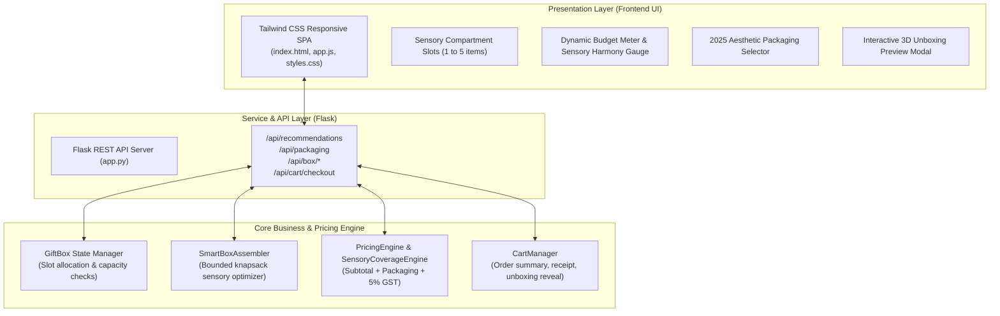

# Person 4 — System Architecture: Gift Box Builder, Cart & Backend

## 1. Position in the Overall Project

Person 4 is the **Gift Box Builder, Cart & Backend** module (Module 4) of the **UnboxJoy Sensory Gift Concierge**. It is the final operational and customer-facing stage connecting product recommendations into a personalized physical gift box and order summary.

```
Person 1 (Questionnaire) ──> Person 2 (AI Personalization) ──> Person 3 (Product Matching) ──> Person 4 (Gift Box Builder & Cart)
```

---

## 2. Component Architecture

The module is partitioned into three layers:



---

## 3. Creative Packaging Aesthetics (2025 Trends)

Inspired by modern packaging innovations (*15 Creative Packaging Ideas for Small Businesses (2025)*, elitecustomboxes.com), Module 4 integrates four packaging styles:

| Packaging Style | Material & Texture | Hardware & Accents | Sustainability Profile | Fee (INR) |
|---|---|---|---|---|
| **Eco-Friendly Kraft Keepsake** | 100% Recycled Biodegradable Kraft Board | Herbal paper shredding, hand-tied natural jute twine | 100% Biodegradable & Compostable | ₹99 |
| **Midnight Matte Luxe Box** | Rigid Paperboard with Soft-Touch Matte | Magnetic latch closure, embossed metallic gold monogram | FSC-Certified Luxury Board | ₹199 |
| **Pastel Blossom Celebration** | Smooth Blush Pastel Finish | Double-faced champagne satin bow, floral embossed liner | FSC Mixed Sourced Board | ₹149 |
| **Minimalist Velvet Chest** | Rigid Wood Core | Royal navy micro-velvet lining, vintage antique brass clasp | Handcrafted Heirloom Keepsake | ₹249 |

---

## 4. Algorithmic Formulations

### 4.1 Real-Time Pricing & Budget Enforcement
For a gift box containing item set $I$ and packaging option $P$:

$$\text{Subtotal} = \sum_{i \in I} \text{price}(i)$$
$$\text{TaxableAmount} = \text{Subtotal} + \text{fee}(P)$$
$$\text{GST} = \text{TaxableAmount} \times 0.05$$
$$\text{GrandTotal} = \text{TaxableAmount} + \text{GST} - \text{Discount}$$
$$\text{RemainingBudget} = B_{\text{target}} - \text{GrandTotal}$$

- If $\text{GrandTotal} > B_{\text{target}}$, the UI flags an over-budget status with visual warnings.
- Strict budget mode prevents adding items that cause budget breach.

### 4.2 Sensory Harmony Metric
The sensory harmony score measures multi-sensory balance across the 5 canonical senses ($S = \{\text{sight}, \text{sound}, \text{smell}, \text{taste}, \text{touch}\}$):

$$\text{SensoryHarmony} = \frac{|\{s \in S \mid \text{count}(s) > 0\}|}{5} \times 100\%$$

### 4.3 Smart Auto-Assembly Knapsack Optimizer
When the user clicks "⚡ Auto-Assemble Box":
1. **Sensory Partitioning**: Group recommendation pool into sets by sense.
2. **Preference Ranking**: Rank products in each sense by `match_score` descending, then price ascending.
3. **Multi-Brand Diversity Guarantee**: Select at most 1 product per brand in the auto-assembled box:
   $$\forall i, j \in I_{\text{box}} \quad (i \ne j \implies \text{brand}(i) \ne \text{brand}(j))$$
4. **Knapsack Budget Constraint**:
   $$\text{GrandTotal}(I_{\text{box}}, P) \le B_{\text{target}}$$

---

## 5. Technology Stack & Dependencies

- **Language**: Python 3.10+
- **Web Framework**: Flask 3.1+, Flask-CORS 6.0+
- **Frontend**: HTML5, Tailwind CSS, Vanilla JavaScript (ES6+)
- **Testing**: Python `unittest`, Flask test client
- **Data Serialization**: JSON, Python `dataclasses`
